[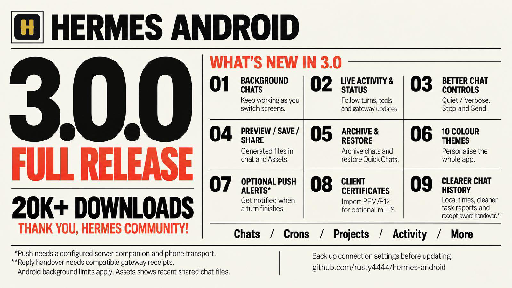](https://github.com/rusty4444/hermes-android/releases/tag/v3.0.0)

# Hermes Android v3.1.7

Android client for [Hermes Agent](https://hermes-agent.nousresearch.com/) — chat with your Hermes sessions from a phone or tablet over local Wi-Fi or a private Tailscale network.

## Screenshots

Ten fresh Android emulator captures, each using a different colour palette. These show the production-signed RC3 UI retained in 3.0.0, with illustrative demo conversations and files rather than private account data. The live-work example uses a local test gateway, not a model response. See [capture details](docs/screenshots/3.0.0/README.md).

<table>
  <tr>
    <td align="center">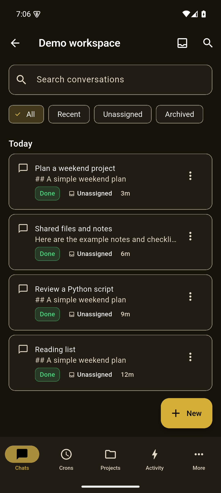<br><sub>Chats · Gold · dark</sub></td>
    <td align="center">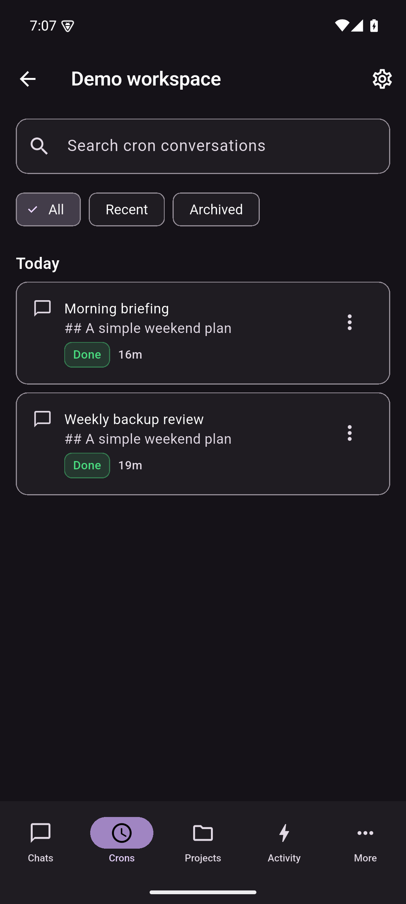<br><sub>Crons · Purple · dark</sub></td>
  </tr>
  <tr>
    <td align="center">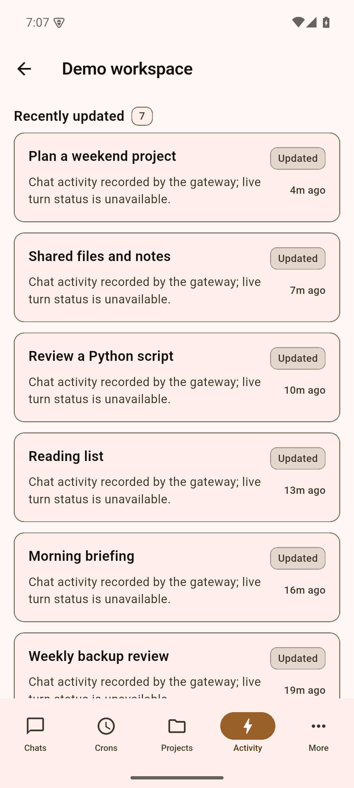<br><sub>Activity · Orange · light</sub></td>
    <td align="center">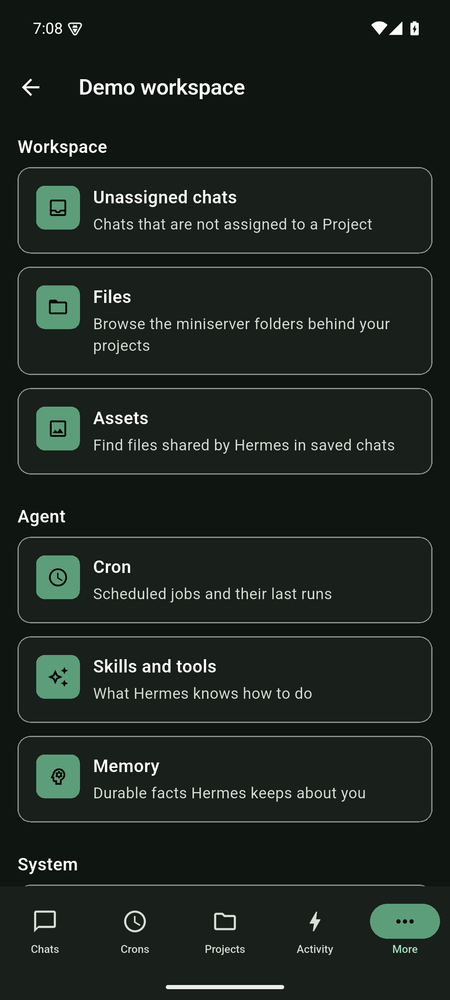<br><sub>More · Green · dark</sub></td>
  </tr>
  <tr>
    <td align="center">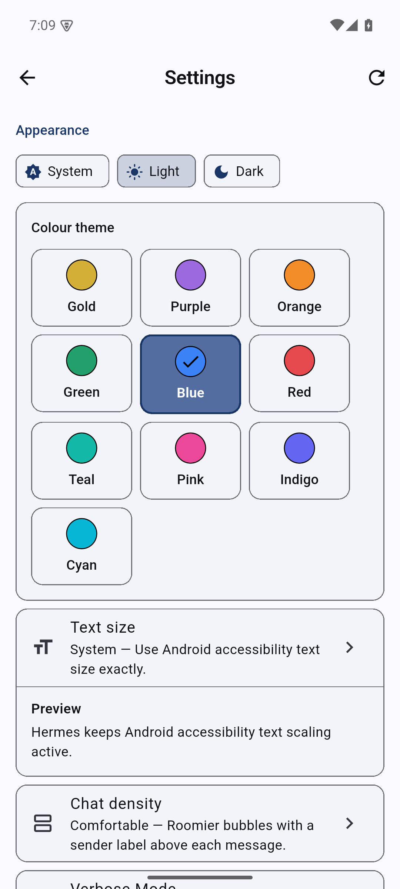<br><sub>Settings · Blue · light</sub></td>
    <td align="center">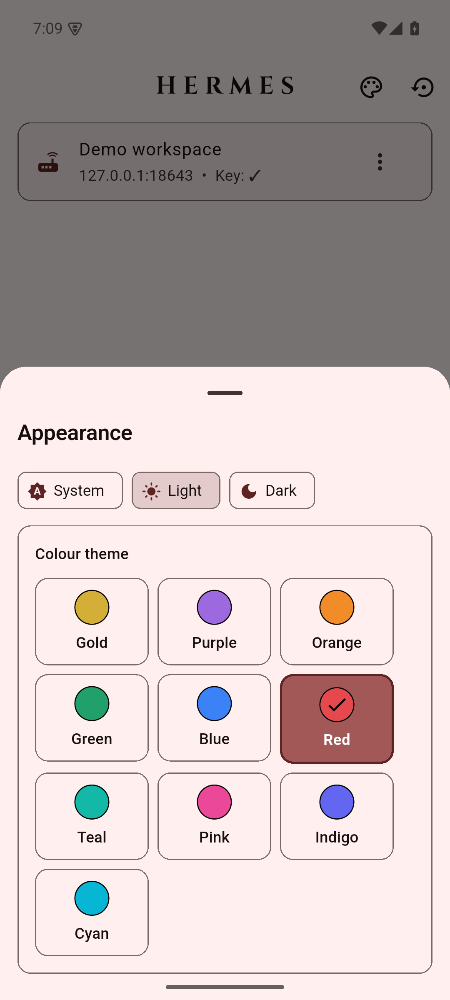<br><sub>Appearance · Red · light</sub></td>
  </tr>
  <tr>
    <td align="center">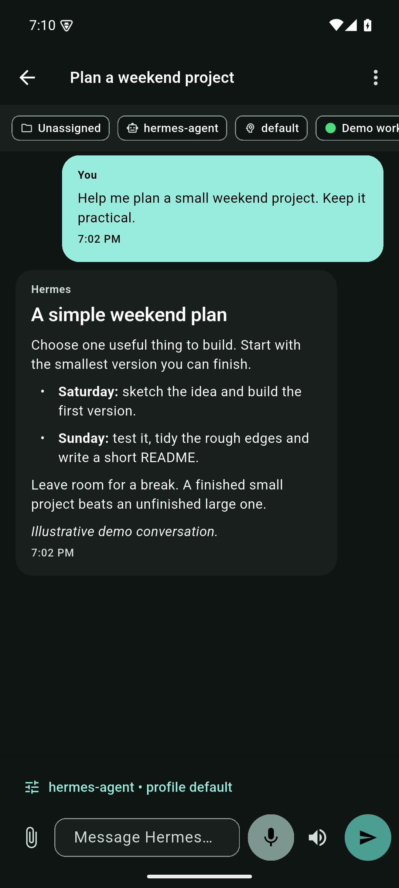<br><sub>Conversation · Teal · dark</sub></td>
    <td align="center">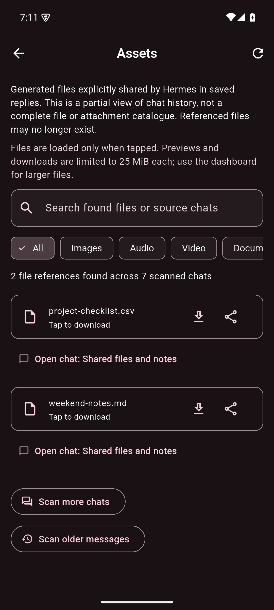<br><sub>Assets · Pink · dark</sub></td>
  </tr>
  <tr>
    <td align="center">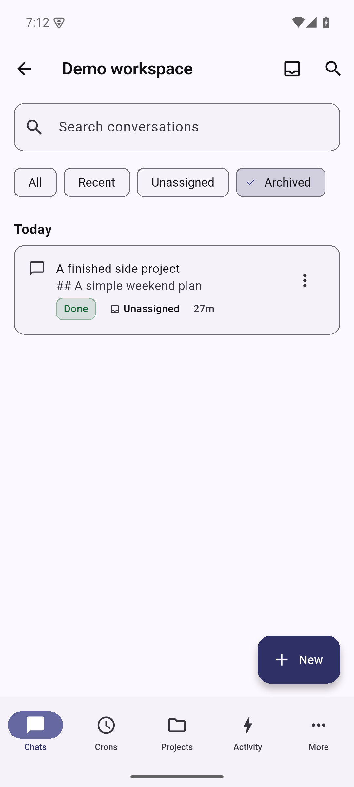<br><sub>Archived chats · Indigo · light</sub></td>
    <td align="center">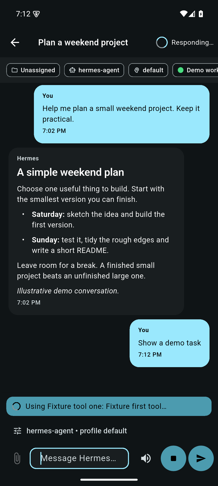<br><sub>Live work and Stop/Send · Cyan · dark</sub></td>
  </tr>
</table>

> **v2.0.0** merges the community Remote Gateway edition contributed by
> [@CristianGCiocoi](https://github.com/CristianGCiocoi), with review and
> testing from [@AI-Guru](https://github.com/AI-Guru) and
> [@grunjol](https://github.com/grunjol). The merge brings a unified Desktop
> Gateway JSON-RPC transport, per-chat model selection, multi-attachment uploads,
> durable turn recovery, voice dictation, and a comprehensive test suite.
> See [CHANGELOG.md](CHANGELOG.md) for the full list and the
> [merge PR thread](https://github.com/rusty4444/hermes-android/issues/81) for
> the community discussion.

## Current release

**3.1.7** (base build **3020**) adds LAN discovery for finding Hermes instances on the local network. The production package, `com.hermesagent.hermes_android`, and signing identity stay the same. Export an encrypted configuration backup before updating; the matching production-signed APK upgrades 3.1.6 and every earlier 3.1 RC in place. Do not uninstall or clear app data.

| Download | Device | Version code |
| --- | --- | --- |
| [ARM64 APK](https://github.com/rusty4444/hermes-android/releases/download/v3.1.7/app-arm64-v8a-release.apk) | Most current Android phones/tablets | `30202` |
| [ARMv7 APK](https://github.com/rusty4444/hermes-android/releases/download/v3.1.7/app-armeabi-v7a-release.apk) | Older 32-bit ARM devices | `30201` |
| [x86_64 APK](https://github.com/rusty4444/hermes-android/releases/download/v3.1.7/app-x86_64-release.apk) | x86_64 Android devices/emulators | `30203` |

[Release and checksums](https://github.com/rusty4444/hermes-android/releases/tag/v3.1.7) · [3.1.7 release notes](docs/releases/3.1.7.md) · [Full changelog](CHANGELOG.md)

Debug builds use the separate `com.hermesagent.hermes_android.dev` package and Android debug certificate. Older production APKs have lower version codes; downgrading can require uninstalling and restoring a backup.

### Before updating

- Updating the APK does not install or configure Hermes host software or the optional mobile-push server companion.
- Quiet mode requires completion metadata for each reply. If an older gateway's saved answers are missing in quiet mode, enable **Verbose Mode**. Saved/live duplicate handover also needs the gateway's optional complete `persisted_turn` receipt and fresh history; older gateways can retain both sources.
- Assets is partial discovery of shared files, not a complete attachment or filesystem catalogue. Downloads are limited to 25 MiB per file.
- Protect encrypted backups and their passwords. Backups can contain connection secrets and imported client private keys. See the [upgrade notes and compatibility limits](docs/releases/3.0.3.md#compatibility-and-delivery-limits).

### Update checks

The app checks GitHub Releases on ordinary launches. An answered check limits requests to once every 12 hours; offline attempts may retry on the next launch. The dialog offers a newer build but does not download or install it. **Later** asks again on the next launch; **Skip this version** stays quiet until another version appears. Shares and Quick Chat shortcuts are not interrupted. In **Settings → About**, use **Check for updates** or disable **Check for updates on launch**. Backups include these choices, not HTTP response caches.

## Release candidate in preparation: 3.2.0-rc.2

The source identity is **3.2.0-rc.2+3022**, with planned release split codes
`30221` (ARMv7), `30222` (ARM64) and `30223` (x86_64), each above the RC.1
maximum `30213`. **Integration validation and publication are pending; 3.1.7
remains the latest published stable.** No candidate download is offered here.

Planned scope is one **Usage** section for Nous, OpenRouter, OpenAI, Claude and
DeepSeek, separating Hermes-recorded activity from real account quotas reported
by the host's `model.options`. OpenAI Codex and paid API access, and Claude OAuth
and paid API access, must remain distinct. Session/weekly remaining percentages
and reset times are shown only where reported; daily quotas are not exposed.
No token or monetary allowance is inferred. These are planned acceptance
requirements, not claims of validated implementation in this metadata checkout.
See [RC.2 scope and pending gates](docs/releases/3.2.0-rc.2.md).

The RC.1 section below is retained as historical candidate documentation.

## Integrated local release candidate: 3.2.0-rc.1

The source identity is **3.2.0-rc.1+3021**, with release split codes `30211`
(ARMv7), `30212` (ARM64) and `30213` (x86_64). This is an unpublished local
candidate, not a downloadable or phone-tested release. **3.1.7 remains the
published stable.**

- **More → Nous Portal** shows gateway Portal status and profile-wide recorded
  usage/model analytics, not a Portal balance, subscription or pricing catalogue.
- Lazily discovered **OpenRouter, ChatGPT, Claude and DeepSeek** entries show
  Hermes-recorded usage for the selected provider. They do not sign in to provider
  accounts or report account balances. Discovery is retriable when unavailable.
- **Settings → Auxiliary models** reads server task assignments and supports
  explicit supported provider/model changes with server confirmation and readback.
  Custom/local endpoint assignments remain read-only; server cost guards stay in force.
- The command palette filters commands, copies the latest visible assistant code
  across received/history handoff, and retains compact/large-text composer fixes.
- Empty untitled cron shells are hidden only with an explicit valid zero count
  and no content preview; unknown-count and content-bearing conversations remain.
- LAN discovery now bounds probes and cancellation, preserves verified endpoint
  scheme/port and scoped IPv6 identity, and does not trust malformed success bodies.

These screens retain the saved dashboard authentication, selected-profile and
client-certificate boundaries. Availability depends on the corresponding host
endpoints; an APK update does not install host features. See the
[RC notes and remaining gates](docs/releases/3.2.0-rc.1.md).

## Background notifications: server setup required

Background push requires the paired **mobile-push server companion**, installed
and enabled separately for the saved connection's Hermes profile. Updating the
Android APK alone does not install it, and the phone's **Refresh / retry** only
rechecks availability—it cannot install server software.

The server operator must copy `server/mobile-push` into the profile's plugins,
generate a private VAPID key, authorise the verified dashboard login in the
companion's policy, and enable both the plugin and policy. Current Hermes plugin
enablement prepares its declared Python dependencies through package management.
Activate it in the dashboard **and** the gateway/turn processes that load its hooks
and sender worker: use supported live activation/reload, or restart affected
processes after draining active work when a new managed generation is selected.
Current host support is limited to the dashboard's launch profile in trusted
in-process mode; secondary-profile hosts cannot forward the required verified
login. Verify both the API and worker are active. Follow the
[server installation runbook](docs/mobile-push-server.md#operator-installation-not-performed-by-this-implementation),
then enable **Settings → Background notifications** on the phone and grant Android
notification permission. See the [phone setup guide](docs/mobile-push-android.md).

Built-in Google-backed transport needs working **Google Play Services** on the
phone, but **no Firebase project**, Firebase credentials or separate distributor
app. An external UnifiedPush distributor is an optional phone transport, not the
server companion; Google-free devices need that alternative. Neither transport
removes the server prerequisite or guarantees background delivery.

## Navigation in 3.0.0

The bottom bar is **Chats → Crons → Projects → Activity → More**. Chats is the
default screen; the separate Home tab has been removed.

- **Chats** lists human conversations with search and All, Recent, Unassigned
  and Archived filters. A compact **Needs you / Running now** section appears
  above the list only when the device has observed relevant work.
  Use **Chats → Archived** for archived conversations, including expired Quick
  Chats; the duplicate archive entry has been removed from More.
- **Crons** lists conversations produced by scheduled jobs, including older
  runs and runs whose job has since been deleted. It has its own search and
  All, Recent and Archived filters. Cron conversations do not appear in Chats.
  The settings button opens the existing cron-job manager; **More → Cron**
  remains available too. Script-only jobs without a conversation are still
  inspected through the job manager, not invented as chat sessions.
- **Projects**, **Activity** and **More** retain their existing roles.

Both conversation browsers show a small first preview while history loads.
Older history is not silently cut off after 2,000 rows. Archived history uses
the saved dashboard connection and profile; a failed read keeps available
rows and offers Retry rather than claiming the archive is empty.

## Chat guidance and shared files

- **Send while Hermes is working:** the composer keeps separate **Stop** and
  **Send** buttons. Remote Gateway sends text as guidance for the current run
  without interrupting it. Legacy REST uses an explicitly labelled **Stop and
  send** action instead. See [Sending while Hermes is working](docs/sending-while-working.md).
- **More → Assets** browses generated files explicitly shared in saved Hermes
  replies, plus recognised successful image-generation results. The same file
  cards appear in the chat timeline, including filesystem Markdown links.
  Tap to preview images, PDF pages, text or videos with playback controls.
  In 3.0.1, videos start paused; DOCX, XLSX and PPTX have offline text previews
  without original layout, images, charts or formatting. Use **Download** to
  choose a save destination, or **Share** to send the original file to another
  app. Legacy `.doc`/`.xls`/`.ppt`, OpenDocument and other unsupported binaries
  remain downloadable. History scans are incremental and downloads are lazy,
  with a 25 MiB per-file limit. This is not a complete attachment or
  filesystem catalogue. See [Browsing chat assets](docs/chat-assets.md).

## Remote Gateway edition highlights

- One Desktop Gateway JSON-RPC session for text, images, and files.
- Copy/select text, Read aloud, Stop, Edit and resend, Regenerate, and export.
- Up to 10 Remote Gateway attachments per draft, capped at 64 MiB total;
  generic files retain the 16 MiB per-file limit.
- Paste more than 3,000 characters into a Remote Gateway chat to attach them as
  `paste.txt`, keeping your instructions in the composer. Short pastes and REST
  chats stay inline. See [Long pastes](docs/long-pastes.md).
- File-backed app cache, metadata-sanitized JPEG/PNG/WebP images, ordered
  sequential upload, accessible reordering, remove, and individual retry.
  Sanitized JPEG inputs remain JPEG; PNG and WebP inputs are emitted as PNG.
- Legacy REST remains fail-closed to one image and does not expose multi-select.
- Per-chat model and thinking effort without changing the profile default.
- Search, Rename, Branch, and Delete for remote conversations.
- Rename a chat from its Chats row's action menu or the open chat's top-right
  menu. The title saves to Hermes and appears on other devices after refresh;
  REST-only connections also support Rename. See [Renaming chats](docs/renaming-chats.md).
- Move conversations into a Project or between Projects from the Chats action
  menu. Destination Projects need a server folder. See [Moving chats](docs/moving-chats.md).
- Pin and unpin chats on this device from the Chats action menu. Local pins
  stay above the dated chat list, including when a chat has moved past the
  first page; they do not change Hermes's server-side pinned flag or another
  device's ordering. Pins are saved per connection and included in app backups.
- **New chat inside a Project** uses that Project's server folder as the
  session working directory before the first prompt, so the chat appears in
  the Project on refresh. Project card chat counts refresh when you return
  from a Project or reselect the Projects tab. A Project without a folder
  cannot file chats on stock Hermes: add a folder first rather than opening
  an unassigned chat.
  **Quick chat** remains deliberately unfiled.
- Native approval, sudo/secret, clarification, reasoning, tool activity,
  notifications, background results, reviews, and subagent status. Expanded
  tool cards show a time for each call, and a collapsed card shows the latest
  known activity. Live events use the phone's observation time; persisted
  results use the server's recorded time. Unknown times are not guessed.
- Tap a delegated task to inspect its recorded messages, tool arguments/results
  and exposed reasoning in a read-only sheet or dialog above the parent chat.
  Missing durable references show an unavailable explanation; omitted compression
  segments show **Partial history**. See [Task timelines](#inspect-a-delegated-task).
- Follow text, exposed reasoning and consecutive tool groups in receipt order
  across REST/SSE and Remote Gateway replies. Expanding a card keeps that choice
  while its contents update. Tool sections start collapsed on each chat visit,
  showing only the current call (or the latest call when none are running).
  Tap to view the full group; leaving and reopening the chat resets that choice.
  Enable Verbose mode to see these sections; they start collapsed.
- **Activity** shows app-observed Remote Gateway turns: waiting for input,
  running, failed and completed, plus an explicit unconfirmed state during
  recovery or when an outcome cannot be proven. Recent turn metadata survives
  app restarts; no prompt, response, title or approval content is stored there.
  It also lists gateway chats updated within seven days, including REST-only
  connections and chats started elsewhere. These are labelled **Updated**, not
  assumed to be running or completed. The tab refreshes while visible,
  pauses beneath other tabs/chat routes and in the background, supports
  pull-to-refresh and opens the relevant chat. A bounded gateway scan is
  labelled partially loaded rather than claiming no activity or an exhaustive
  count. This is not a complete server audit log: live outcomes from other
  clients and historic per-turn outcomes predating this build are unavailable.
- Persistent reconnect/session resume and defensive retry handling.
- App-owned stock Gateway turns outlive an open chat route. Reopen a chat to
  reattach, including while other chats run. Pending markers survive process
  restart; the app checks server history without resubmitting uncertain prompts.
- Background protection uses one foreground service with a required disclosure
  and quiet per-chat ongoing entries. Notification taps open the relevant chat;
  permission, preferences and Android lifecycle restrictions still apply.
- Background notifications can use built-in Google-backed delivery without a
  separate app or manual push details. External UnifiedPush remains available.
  Enable the separate server companion and opt in on the phone; server policy
  controls which current and future chats are eligible. See
  [Background work and push](#background-work-and-notifications).

### Gateway transport compatibility

Stock Hermes Agent releases do not advertise the experimental
`capabilities.turn_recovery` v2 contract in `gateway.ready`. The app uses the
stock Desktop Gateway transport for those connections. Its app-owned session
keeps user-started turns across chat navigation and reconciles persisted history
after reconnect or process restart. It does not resubmit an uncertain prompt.
After an outage, the app keeps recovery pending until it can verify the server's
state. A proven-idle turn with no recorded terminal outcome becomes inactive
with an outcome-unknown status. It does not generate a completion alert.

In Verbose Mode, saved history and retained received output remain independent
sources. A complete gateway `persisted_turn` receipt plus fresh history containing
all addressed rows can prove the handover to saved content and remove the covered
live copy. Matching text, an admission baseline or idle status cannot prove it.
Older gateways or lagging history may retain repetition across sources. Received
output is bounded and temporary within the app/connection session, not an offline
transcript archive. See [Chat presentation](docs/chat-presentation.md).

The experimental v2 path adds a separate durable exactly-once recovery contract
when the gateway advertises support. A legacy-transport capability notice refers
to that contract; it does not mean stock chat reattachment is unavailable. Neither
transport guarantees an Android background connection or delivery after Force stop.

See [CHANGELOG.md](CHANGELOG.md) for the complete release history and
[docs/HERMESAPK_DEVELOPMENT_LOG.md](docs/HERMESAPK_DEVELOPMENT_LOG.md) for the
sanitized implementation and validation record.

## What's new in v3.1.7

- Find Hermes on LAN discovery: IPv4 and IPv6 subnet probing, HTTPS-aware,
  bounded concurrency, and test-file cleanup.

See [the 3.1.7 release notes](docs/releases/3.1.7.md) for scope and
compatibility limits.

## What's new in v3.1.6

- Source-only release preparation for the README release window (`3.1.6+3019`).
  This tag has no published APKs; use the current stable downloads above.

See [the historical 3.1.6 notes](docs/releases/3.1.6.md). Their production-build
and verification statements are not evidence of a published download.

## What's new in v3.1.5

- Source-only release preparation for the README release window (`3.1.5+3018`).
  This tag has no published APKs; use the current stable downloads above.

See [the historical 3.1.5 notes](docs/releases/3.1.5.md). Their production-build
and verification statements are not evidence of a published download.

## Features

- **Hermes chat on Android** — browse sessions, create new chats, and send prompts to your Hermes Agent.
- **Streaming responses:** Remote Gateway chat uses JSON-RPC over WebSocket;
  REST chat uses `POST /v1/chat/completions` with SSE. Live text, exposed reasoning
  and tool activity keep their receipt order without changing request history.
- **Messaging-style UI:** ten colour palettes, independent dark/light/system appearance, Markdown, local message times and responsive phone/tablet layouts.
- **Hermes branding:** the gold/black default remains available alongside nine other full-app palettes. Chat surfaces, controls, code blocks and navigation follow the selected theme.
- **Gateway API integration** — sessions and chat run through the Hermes Gateway API Server, normally on port `8642`, with HTTP and HTTPS endpoints supported. Reverse-proxy deployments can set a gateway path prefix that is applied before `/api` and `/v1` routes.
- **Dashboard integrations:** Memory, Cron Jobs, Skills, Settings and Remote Gateway chat use the authenticated Hermes dashboard (default port `9119`, configurable per connection). Use the built-in password login or a trusted reverse proxy. Current Hermes requires an authentication provider before the dashboard can bind to a non-loopback address; `--insecure` no longer bypasses this requirement.
- **Model settings** — view and change the configured Hermes model where the dashboard exposes model settings.
- **Cron management** — list, trigger, pause/resume, create, edit, and delete scheduled Hermes cron jobs.
- **Skills browser** — view available Hermes skills with descriptions and trigger conditions.
- **Memory viewer:** More → Memory opens saved facts about you from `USER.md`,
  with a separate Agent notes tab for `MEMORY.md`. Reads follow the connection’s
  Hermes profile; long facts can be read in full. The view is read-only and does
  not enumerate external providers such as MemPalace. See [Saved memory facts](docs/MEMORY_FACTS.md).
- **Verbose mode toggle** — switch between conversation-only chat and retained
  reasoning, tools, tasks and metadata, all initially collapsed. Current work
  remains visible in the bottom status bar in either mode.
- **Task inspection:** read recorded delegated-task history without joining or
  controlling the child runtime. The viewer preserves the parent chat and draft.
- **Background work:** keep active stock Gateway turns above chat routes, review
  device-local battery/notification settings and opt in to separate UnifiedPush.
- **Appearance:** Gold, Purple, Orange, Green, Blue, Red, Teal, Pink, Indigo and Cyan, with separate Dark / Light / System controls.
- **Keyboard handling** — Enter inserts a new line; use the on-screen Send button to submit. The composer stays editable during setup and replies, so you can draft a follow-up without waiting. A failed submission restores its prompt only if you have not edited the cleared composer. FAB to scroll to bottom.
- **Voice chat** — microphone dictation sends recognised speech to Hermes, with optional text-to-speech replies.

## Quick start

### Prerequisites

- Android device or emulator (Android 8+).
- Hermes Agent installed on the host machine.
- Hermes Gateway API Server reachable from the Android device.
- `API_SERVER_KEY` from the Hermes host environment (`~/.hermes/.env`).
- Optional: Hermes dashboard reachable for Memory/Cron/Skills/Settings screens.

Hermes Agent docs: <https://hermes-agent.nousresearch.com/docs>

### Install the APK

Download the latest APK from this repository's
[GitHub Releases](https://github.com/rusty4444/hermes-android/releases) page.

For most Android phones, install the ARM64 APK:

```bash
adb install -r app-arm64-v8a-release.apk
```

If sideloading directly on Android, enable **Install unknown apps** for your browser or file manager, then open the downloaded APK.

### 1. Start the Gateway API Server

The Android chat/session features connect to the Hermes Gateway API Server. It must bind to an address your phone can reach, not only `127.0.0.1`.

Use your normal Hermes gateway/API-server startup command and confirm:

- host/IP is reachable from Android
- port is usually `8642`
- `API_SERVER_KEY` is available in `~/.hermes/.env`

### 2. Optional: start the dashboard for drawer features

Memory, Cron Jobs, Skills, and Settings use the Hermes dashboard API (default port `9119`).

Configure a dashboard authentication provider before exposing it to your LAN or
tailnet. For password login, Hermes uses `dashboard.basic_auth.username`, a
scrypt `dashboard.basic_auth.password_hash`, the bundled `basic` auth plugin,
and a separate session-signing secret. Follow the current
[Hermes documentation](https://hermes-agent.nousresearch.com/docs) for setup;
keep passwords and signing secrets out of commands, chat and committed files.

Start the configured dashboard:

```bash
hermes dashboard --host 0.0.0.0 --port 9119 --no-open
```

Enter its username/password in the app's **Dashboard / Proxy Settings** dialog
(see [Dashboard access](#4-optional-configure-dashboard-access)). An existing
trusted reverse proxy can supply identity instead. A public `/api/status`
response proves reachability, not successful login: validate a protected route
after authenticating.

> `--host 0.0.0.0` is required when connecting from another device. A localhost-only dashboard cannot be reached from Android.

### 3. Connect the app

1. Put the Android device and Hermes host on the same Wi-Fi/LAN (or connect via Tailscale — see below).
2. Find the Hermes host IP:

   ```bash
   # macOS
   ipconfig getifaddr en0

   # Linux
   hostname -I | awk '{print $1}'
   ```

3. Open the Hermes Android app.
4. Tap **+** to add a connection.
5. Enter:
   - **Label:** any name, e.g. `Home`
   - **Host:** the host IP, e.g. `192.168.1.50`
   - **Port:** `8642`
   - **API Key:** `API_SERVER_KEY` from the Hermes machine
6. If your deployment is behind a reverse proxy path, expand **Custom proxy and dashboard details** and set the gateway/dashboard prefixes there. Do not put URL paths in the Host field; the Host field is just the scheme, hostname, and optional port.
7. Tap the saved connection to browse sessions.
8. Tap a session to start chatting, or create a new one.

### 4. Optional: configure dashboard access

The drawer screens (Memory, Cron Jobs, Skills, Settings) talk to the Hermes
dashboard, which can run on a different port from the Gateway API Server and may
be password-protected. Configure it per connection — either while adding the
connection (expand **Custom proxy and dashboard details** in the Add Connection dialog) or
afterwards:

1. On the connections list, tap the **⋮** menu on a connection → **Dashboard / Proxy Settings**.
2. Fill in:
   - **Gateway path prefix** — optional reverse-proxy path before gateway `/api`
     and `/v1` routes, e.g. `/profile/peter`.
   - **Dashboard path prefix** — optional reverse-proxy path before dashboard
     `/api` routes, e.g. `/dashboard`.
   - **Dashboard behind proxy** — enable this when the proxy injects dashboard
     authentication and the app should not fetch a dashboard SPA token or log in
     with username/password.
   - **Dashboard Port** — leave blank to use the default (`9119` for HTTP, or the
     same external port for HTTPS deployments), or set an explicit port if your
     dashboard is exposed elsewhere.
   - **Username / Password** — the dashboard's password-login credentials.
     Leave both blank only when a trusted proxy supplies identity or for a
     local loopback dashboard. `--insecure` is not a remote-auth bypass.
   - **Hermes profile** — only when the dashboard is a *machine-level* one
     (`hermes dashboard` / `hermes serve` without `--isolated`) that hosts
     several profiles. Hermes scopes each JSON-RPC call on that socket by a
     `profile` field in the request, and falls back to its own default
     profile when it is missing, so without this field chats can quietly land
     in the wrong profile. Use the profile name exactly as in `hermes profile
     list`, e.g. `sol`. Leave blank for an isolated per-profile dashboard.
3. Tap **Save**. The app validates the settings against the dashboard before
   storing them.

When credentials are set, the app authenticates via the dashboard's
`/auth/password-login` flow and reuses the returned session cookie — the same
mechanism the Hermes desktop client uses.

## Connect remotely with Tailscale

Tailscale gives your phone and Hermes machine a private encrypted network, so you do **not** need to expose Hermes directly to the public internet.

Tailscale website: <https://tailscale.com/>

### Install Tailscale on Android

1. Install Tailscale for Android: <https://tailscale.com/download/android>
2. Sign in with the same Tailscale account/tailnet used by your Hermes machine.
3. Leave Tailscale connected while using the Hermes app.

### Install Tailscale on the Hermes machine

Install Tailscale for your OS: <https://tailscale.com/download>

Examples:

```bash
# macOS with Homebrew
brew install --cask tailscale

# Debian/Ubuntu
curl -fsSL https://tailscale.com/install.sh | sh
sudo tailscale up
```

After the Hermes machine is connected, get its Tailscale address:

```bash
tailscale ip -4
```

You can also enable MagicDNS and use the machine name instead of the `100.x.y.z` IP:

- MagicDNS docs: <https://tailscale.com/kb/1081/magicdns>

### Connect the app over Tailscale

In the Android app connection dialog:

- **Host:** the Hermes machine Tailscale IP, e.g. `100.64.12.34`, or its MagicDNS name
- **Port:** `8642`
- **API Key:** `API_SERVER_KEY`

If using Memory/Cron/Skills/Settings remotely, keep the dashboard reachable on the same Tailscale host at port `9119`.

## Connect over HTTPS

For hosted/reverse-proxy deployments (e.g., Hugging Face Spaces, VPS with nginx/Caddy), enter the full HTTPS URL in the **Host** field:

```text
https://your-hermes-host.example.com
```

If no port is included, the app uses port `443`. If your HTTPS service uses a custom port, either include it in the URL (`https://host.example.com:8443`) or set the Port field to that value before connecting.

Leave the **Port** field blank and the app infers the scheme default — `443` for HTTPS, `8642` for HTTP. A value typed into **Port** is always used as-is, including `8642` over HTTPS (for example a `tailscale serve` endpoint that terminates TLS on the API-server port). A port inside the Host URL (`https://host.example.com:8443`) takes precedence over the Port field.

For HTTPS connections, dashboard drawer screens use the same external HTTPS port. For local HTTP/LAN connections, chat uses port `8642` and dashboard screens use port `9119`.

### Reverse-proxy paths

If your proxy exposes Hermes under URL paths, keep the **Host** field to the origin only and put paths in **Custom proxy and dashboard details**:

```text
Host: https://your-hermes-host.example.com
Port: 443
Gateway path prefix: /profile/peter
Dashboard path prefix: /dashboard
Dashboard behind proxy: on, if the proxy injects dashboard auth
```

With that setup, the app calls gateway routes such as
`https://your-hermes-host.example.com/profile/peter/v1/chat/completions` and
dashboard routes such as
`https://your-hermes-host.example.com/dashboard/api/model/info`.

### Optional client certificates (mTLS)

For an HTTPS proxy that requires a client identity, use the connection editor's certificate import. Pick a PEM certificate/key pair in either order, a combined PEM file, or a PKCS#12 `.p12`/`.pfx` identity. The app asks for a password after selecting a protected file and validates the identity before reporting it loaded. Imports are limited to 1 MiB.

The saved identity applies to that connection's API, dashboard, WebSocket, search and file access. It does not replace API/dashboard credentials or bypass server certificate trust. Private keys remain in app-private files, not Android KeyChain/non-exportable hardware storage; key passphrases use secure credential storage. Encrypted backups can include the portable identity and passphrase, so protect them as credentials. Remove or replace an identity through the connection editor.

Thanks to [@smhc](https://github.com/smhc) for the certificate support and mobile picker improvements. See the [mTLS report and device-specific limits](docs/mtls-report.md).

### Security notes

- Prefer Tailscale/VPN for remote use.
- Do not port-forward the Gateway API Server or dashboard directly to the public internet.
- Rotate `API_SERVER_KEY` if it is shared or exposed.
- Local/Tailscale examples use HTTP, so the private network boundary matters. Use HTTPS for public or hosted endpoints.

## Architecture

```text
Android app (Flutter)
├─ Gateway API Server, port 8642 or HTTPS proxy prefix
│  ├─ GET /api/sessions
│  ├─ GET /api/sessions/{id}/messages
│  └─ POST /v1/chat/completions  (SSE streaming)
└─ Hermes dashboard, port 9119 or HTTPS proxy prefix
   ├─ /api/memory
   ├─ /api/cron/jobs
   ├─ /api/skills
   ├─ /api/model/*
   ├─ /api/auth/ws-ticket → /api/ws  (Remote Gateway JSON-RPC)
   └─ /api/sessions/{id}/messages  (richer dashboard transcript)
```

## Using the app

### Chat screen

- **Send messages:** Type in the input field and tap Send. Enter/Return inserts a new line.
- **Streaming responses:** Replies arrive through Remote Gateway JSON-RPC or legacy REST/SSE. The chat follows new content while you are at the end; scrolling up lets you read earlier messages.
- **Current work:** the responding bar shows the active tool, reasoning or gateway status in either mode. Verbose Mode also exposes retained tool cards, starting collapsed.
- **Verbose mode** — Toggle in the app settings. Off shows the conversation only;
  on exposes retained reasoning, tools, tasks and message metadata in collapsed
  sections. The bottom status bar shows current work in both modes.
- **Markdown rendering** — Assistant messages render markdown (code blocks, tables, lists, links).
- **Message times:** local-clock footers follow your device locale and 12/24-hour setting. A tooltip shows the full date and server-recorded versus device-observed provenance. Missing server times are not guessed. Conversation lists retain relative ages.

### Inspect a delegated task

1. Tap a task row in the parent chat's delegated-task card. The app opens
   **Task timeline** above the chat, as a phone sheet or a wider-screen dialog.
2. Expand recorded tool calls for the server's arguments and results, or expand
   exposed reasoning. **Refresh task history** checks for saved rows;
   **Load older** requests another bounded page. Live previews carry a separate
   label and do not count as recorded transcript rows.
3. Close the viewer or press Back to return to the parent's draft and scroll
   position. The viewer cannot send, steer, stop or watch the child runtime.

Configure authenticated dashboard access for that saved connection first. The
API-server key alone cannot read the richer task transcript. Old tasks without a
durable child-session reference show **Task transcript unavailable**. A gateway
may omit a newer compression segment or older ancestors; **Partial history**
identifies that gap. Refresh can retry, but reopening does not prove complete
history. See [Delegated-task timeline](docs/DELEGATED_TASK_TIMELINE.md) for the
read-only API, identity checks and backend limits.

### Background work and notifications

In the connection's **Settings → Background work**, use **Keep chats active in
the background** to control device-local connection protection. Turning it off
does not stop server work. Use **Battery optimisation settings** to review
Android's restrictions; the app does not request an exemption on startup.

While protection is active, Android requires a foreground-service disclosure.
Hermes uses one service for active chats and separate quiet ongoing entries for
their status. **Settings → Notifications** controls optional alerts. Returning
to the app does not mean all chat notifications should disappear: ongoing work
and other chats retain their own state. Grant or revoke OS notification permission
in Android settings; the app refreshes that status on return without another
startup prompt.

Reopening a stock Gateway chat reattaches to its app-owned turn. After a network
drop or process restart, the app reconciles pending markers with saved server
history. An acknowledgement or a lost connection does not prove completion;
uncertain work remains unresolved and the app does not resubmit its prompt.

For notifications without a live app socket:

1. The server operator installs/enables the paired `server/mobile-push` companion
   and authorises your verified dashboard login. A personal-server owner can be
   explicitly granted current and future chats with `owner_all_sessions: true`;
   restricted accounts keep their restrictions. Installing the APK does not set
   up the server. Follow [Server companion setup](docs/mobile-push-server.md).
2. In the connection's Settings, enable **Background notifications** and accept
   Android's notification permission prompt. On Google-enabled phones, the
   built-in transport needs no separate app, URLs, keys or chat IDs. External
   UnifiedPush is an optional advanced alternative for Google-free devices.
3. Keep/reopen Hermes until **Active**. An encrypted challenge and authenticated
   confirmation establish registration; **Pending** does not mean active. Retry
   after a connection failure. If no supported transport or server is available,
   the app explains the prerequisite rather than reporting success.
4. Disable background notifications to revoke consent. Local delivery stops
   before server revocation; failed remote revocations remain pending for retry.

One installation binds one saved connection. Automatic subscriptions cover only
that login's currently authorised durable chats, including future chats allowed by
server policy—not other users or profiles. Existing selected-session subscriptions
are not silently expanded; disable and enable again to choose automatic scope.

The built-in transport uses Google's network and Play Services, but bundles no
Firebase or proprietary Google messaging SDK. Devices without working Play Services
need a compatible external distributor. See the [dependency licence notice](third_party/embedded-push-notice.md)
for the upstream licence discrepancy and pre-release review requirement.
Push hints and notifications omit
chat text; a tap resolves its destination through the authenticated server feed.
Push cannot approve an action or resubmit a prompt. See
[Android UnifiedPush setup and privacy](docs/mobile-push-android.md).

Delivery remains best-effort. Force stop, OEM battery controls, Doze, offline
devices, distributor availability and notification permissions can prevent or
delay it. A foreground service or battery exemption does not guarantee a live
connection, and push requires its own working server/distributor setup.

### Voice chat

The chat input bar has two voice controls:

| Button | Icon | What it does |
|--------|------|-------------|
| **Mic** | 🎤 / 🎤🔴 | Tap to start voice dictation. Speak your message — it appears in the input field and sends automatically when you pause. Tap again (or the red stop icon) to cancel. |
| **Voice reply toggle** | 🔊 / 🔇 | Toggles whether Hermes reads its response aloud after a voice-input message. On = 🔊 (volume up), Off = 🔇 (volume off). |

**How voice replies work:**

1. Tap the mic, speak your question, and wait for the recognition to finish (the text appears and auto-sends).
2. Hermes streams its response as text in the chat as usual.
3. After the full response arrives, if the voice reply toggle is on (🔊), the app reads the response aloud using text-to-speech.

Voice replies **only** trigger when you send a message via the mic button. Typed messages produce text responses only.

#### Setting up text-to-speech (Android)

Spoken replies require Google Text-to-Speech to be installed and configured on your device. The app uses the device's built-in TTS engine — it does not bundle its own voices.

**Step-by-step:**

1. **Install Google Text-to-Speech** — If not already on your device, install from the Play Store: [Google Text-to-Speech](https://play.google.com/store/apps/details?id=com.google.android.tts)
2. **Set as default engine** — Settings → Accessibility → Text-to-speech output → Preferred engine → **Google Text-to-Speech**
3. **Download voice data** — In the same TTS settings screen, tap the gear icon ⚙️ next to Google Text-to-Speech → Install voice data → select **English (Australia)** or your preferred English voice → download
4. **Check media volume** — TTS uses the **media** audio stream, not the ringer. Turn up media volume and make sure your phone isn't in silent/vibrate-only mode.
5. **Test TTS** — In the TTS settings screen, tap "Play" to hear a test phrase. If you hear it, the app should work.

**Troubleshooting voice:**

- **Mic button does nothing** — Speech recognition may be unavailable on your device. Ensure Google app is installed and has microphone permission.
- **Voice reply toggle is on (🔊) but Hermes doesn't speak** — Google TTS is likely not installed or has no voice data downloaded. Follow the TTS setup steps above.
- **Hermes speaks quietly or too fast** — Adjust speech rate and volume in Settings → Accessibility → Text-to-speech output.
- **Recognition is inaccurate** — Speak clearly, reduce background noise, and check that the device's system language includes English.

### Session list

- Browse all Hermes sessions.
- Tap a session to open its chat.
- Use a chat's **⋮** menu to **Pin on this device** or **Unpin on this device**.
  Pinned chats appear first in the Workspace Chats browser and the classic
  session list. Filters and search still apply, and the pin is only stored in
  the Android app, not synced to the Hermes server.
- Pull to refresh the session list.
- Create a new session from the session list header.

### Navigation drawer (☰)

Access these dashboard-powered screens:

- **Memory:** read the connected profile's saved `USER.md` facts and `MEMORY.md` agent notes, not an external-provider or complete conversation-memory catalogue.
- **Cron Jobs** — List all scheduled cron jobs. Trigger, pause/resume, create, edit, or delete jobs.
- **Skills** — Browse available Hermes skills with descriptions and trigger conditions.
- **Settings** — View and change the configured Hermes model, theme preference, and verbose mode.

### Theme

Choose **Gold, Purple, Orange, Green, Blue, Red, Teal, Pink, Indigo or Cyan** in **Settings → Appearance**, or use the palette button on the connection screen before connecting. Select **Dark**, **Light** or **System** independently of the palette.

The palette applies to the whole app, including existing chats, code blocks, dialogs and navigation. Choices persist across restarts and encrypted backup/restore. The launcher icon and native splash retain their branding. See [Appearance and themes](docs/APPEARANCE_THEMES.md).

### Cron job management

The Cron Jobs screen supports full CRUD:

- **List** — See all jobs with status (enabled/disabled), next run, and schedule.
- **Create** — Tap **+** to add a new job with schedule (cron expression or interval), prompt, and optional skills.
- **Edit** — Tap a job to modify its schedule, prompt, skills, or status.
- **Trigger** — Manually run a job immediately.
- **Pause/Resume** — Toggle job enabled state.
- **Delete** — Remove a job (with confirmation).

## Development

```bash
cd hermes-android
flutter pub get
flutter analyze
flutter test
flutter run -d android
```

## Build release APKs

```bash
flutter clean
flutter pub get
flutter build apk --release --split-per-abi
mkdir -p release-apks
cp build/app/outputs/flutter-apk/app-*-release.apk release-apks/
```

`pubspec.yaml` declares the base Android `versionCode`. The F-Droid ABI-split
block in `android/app/build.gradle.kts` derives per-ABI codes as
`base * 10 + ABI code` (armeabi-v7a = 1, arm64-v8a = 2, x86_64 = 3), so the
codes stay ordered armeabi-v7a < arm64-v8a < x86_64 as fdroiddata requires.
For v3.0.6, base `3010` produces codes `30101`/`30102`/`30103`.
Before publication, CI verifies all three actual APKs: package, version, ABI,
effective code, production signer and required licence/source assets. Releases
include checksums and exact-commit source/relink materials. Release-floor checks
continue to apply to the base value and must not rely on the ABI digit alone.

Output files:

```text
build/app/outputs/flutter-apk/app-arm64-v8a-release.apk
build/app/outputs/flutter-apk/app-armeabi-v7a-release.apk
build/app/outputs/flutter-apk/app-x86_64-release.apk
```

## Release checklist

Every release PR must complete [`CODE_QUALITY_CHECKLIST.md`](CODE_QUALITY_CHECKLIST.md) before tagging or publishing APKs. The checklist covers analysis, architecture, UX, security, release, and manual smoke-test checks.

Minimum release flow:

1. Update `pubspec.yaml` version.
2. Complete `CODE_QUALITY_CHECKLIST.md` and record any exceptions in the release PR.
3. Build split release APKs.
4. Tag the release, e.g. `v1.0.0`.
5. Create a GitHub Release with all APK assets.
6. Confirm the repository visibility and release assets on GitHub.

## Troubleshooting

### I can see sessions but dashboard drawer screens fail

Chat/session features use port `8642`. Memory, Cron Jobs, Skills, and Settings use the dashboard on port `9119`. Start the dashboard with `--host 0.0.0.0` and make sure port `9119` is reachable over Wi-Fi or Tailscale.

### Chat fails with an auth error

Check that the Android connection's API key matches `API_SERVER_KEY` from the Hermes machine (`~/.hermes/.env`).

### The app cannot find the host

- Verify phone and host are on the same Wi-Fi or same Tailscale tailnet.
- Try the raw IP before a hostname.
- Check local firewall rules for ports `8642` and `9119`.
- On Android, ensure the app has network permission (granted by default).

### Streaming stops or messages don't appear

- The SSE connection may have timed out. Pull to refresh the session list and re-enter the chat.
- Check reachability with `curl http://<host>:8642/health`. This public endpoint does not validate the API key; session/model reads require Bearer authentication.
- If using a reverse proxy, ensure it supports long-lived SSE connections (no aggressive timeouts).

### Dashboard screens show empty or error

- Verify the dashboard is running with `--host 0.0.0.0` and a configured password/OAuth authentication provider or trusted proxy. Current Hermes ignores the deprecated `--insecure` flag rather than disabling authentication.
- If the dashboard is password-protected, set the username/password under **⋮ → Dashboard / Proxy Settings** (or **Custom proxy and dashboard details** when adding the connection). A 401 here means the credentials are wrong.
- If the dashboard sits behind a reverse-proxy path, set **Dashboard path prefix**. If the proxy injects dashboard auth, enable **Dashboard behind proxy** so the app sends clean requests.
- Check the dashboard port matches the connection (default `9119` for local/Tailscale, same HTTPS port for hosted; override it in Dashboard / Proxy Settings if needed).
- The dashboard must be on the same host as the Gateway API Server for the app's drawer to reach it.

### Voice dictation or spoken replies aren't working

- **Spoken replies not working** — Install Google Text-to-Speech, set it as the default engine, and download English voice data. See [Setting up text-to-speech](#setting-up-text-to-speech-android) above for step-by-step instructions.
- **Speech recognition not working** — Ensure the Google app is installed and has microphone permission (Settings → Apps → Hermes → Permissions → Microphone).
- **Voice reply toggle is off** — Check the speaker icon in the chat input bar: 🔊 = on, 🔇 = off. Tap it to enable spoken replies.
- **Media volume is zero** — TTS uses the media audio stream, not the ringer. Turn up media volume with the physical volume buttons while on the home screen.
- **Hermes speaks but audio is quiet or fast** — Adjust speech rate and volume in Settings → Accessibility → Text-to-speech output.

### Host field examples

The app accepts any of these forms and normalizes them when saving:

```text
192.168.1.50
192.168.1.50:8642
http://192.168.1.50:8642
100.64.12.34
hermes-machine.tailnet-name.ts.net
https://your-hermes-host.example.com
https://your-hermes-host.example.com:8443
```

For hosted paths such as `https://your-hermes-host.example.com/profile/peter`, enter `https://your-hermes-host.example.com` as the host and `/profile/peter` as the **Gateway path prefix**.

## Project structure

```text
lib/
├── main.dart                          # App shell, saved connections, navigation drawer
├── core/
│   ├── models/
│   │   ├── attachment_draft.dart       # File-backed image/file composer model
│   │   ├── connection.dart             # SavedConnection model and host normalization
│   │   └── session.dart                # Session model
│   ├── screens/
│   │   ├── session_list_screen.dart   # Session browser
│   │   ├── chat_screen.dart           # Remote Gateway and legacy REST/SSE chat
│   │   ├── settings_screen.dart       # Model/theme/app settings
│   │   ├── memory_screen.dart         # Memory viewer
│   │   ├── skills_screen.dart         # Skills browser
│   │   └── cron_screen.dart           # Cron job manager
│   ├── services/
│   │   ├── attachment_draft_service.dart # Cache, sanitization, limits, upload order
│   │   ├── connection_manager.dart    # Saved connections, Gateway API, Dashboard API
│   │   └── ws_client.dart             # Active Remote Gateway JSON-RPC transport
│   └── utils/
│       └── responsive.dart            # Phone/tablet breakpoints
└── assets/
    └── icon/
        └── icon.png                   # App icon source
```

## Credits

**AI assistance:** Hermes Agent assists with implementation, research, code
review and regression tests, including the saved-memory viewer and compact chat
details in v2.1.33. Existing contributor credits below remain unchanged.
Automated checks do not substitute for device validation; release notes list
the checks performed.

- **igitur** — reported the REST/API-server approval path regression (#229) with
  server-side frame evidence and a precise reproduction of the malformed SSE
  choices crash.
- **mordekai-lab** — fixed approval-dialog route ownership and added navigation
  regression tests in PR #220 (v3.0.5), then made mobile notifications clearer
  and more private with regression tests in PR #224 (v3.0.6). The original
  commit history is preserved.
- **smhc** — contributed optional imported client certificates in PR #166, then
  improved Android/iOS certificate picking, protected-file password entry and
  loaded-certificate layout in PR #187, including a physical Android mTLS report.
  Maintainer follow-ups cover encrypted PEM imports and certificate-chain parsing.
- **krotname** (Andrei Ovcharenko) — fixed duplicate final answers after
  Gateway interim previews, including late reasoning and widget regressions
  (PR #153, v2.1.23). A maintainer follow-up handles exact-match edge cases.
- **simplaerai-sv** — kept the attachment composer, multiline captions, and
  Send button usable above the keyboard across narrow, landscape, and
  large-text layouts, with focused widget regressions in PR #139 (v2.1.18).
- **dadofsambonzuki** — fixed batch clarification navigation so answering a
  question does not dismiss the chat or another prompt (PR #145, v2.1.22).
- **HorCyChangGenitek** — reported and documented the API-only model-picker
  failure that incorrectly required the Desktop Dashboard on port `9119`
  (#129). Fixed in v2.1.17.
- **maebahesioru** — corrected Gateway session liveness handling with focused
  regressions in PR #121 (v2.1.9), added complete Flutter localisation and
  on-device Japanese QA in PR #115 (v2.1.11), then added Android per-app locale
  support and the bounded idle-session fallback in PRs #125 and #123 (v2.1.12),
  selectable message text with dark-theme and localisation coverage in PR #127
  (v2.1.13), and accessible single-line navigation labels across every shipped
  locale in PR #126 (v2.1.14), followed by desktop-parity notifications in PR
  #128 and durable per-chat drafts with live status refresh in PR #131
  (v2.1.15).
- **igitur** — diagnosed and fixed explicit HTTPS port handling (PR #111) and
  preserved running Hermes turns when leaving a chat (PR #113), with focused
  regression coverage for both fixes (v2.1.8). They also added the in-app
  GitHub release update check, translations, and initial regressions in PR #143
  (v2.1.20). They contributed Compact chat density and persistent tool-card
  expansion with widget regressions in PRs #147 and #148 (v2.1.22).
- **Thaeland** — contributed the extensive stock-gateway compatibility and
  reliability work in PR #106: durable reconnect recovery, Projects and Chats
  wire-contract fixes, safe pagination and folder ownership, transport
  hardening, and the accompanying regression suite. Released in v2.1.7. They
  later added secure inline `MEDIA:` delivery cards and the complete gateway
  file-type contract in PR #137 (v2.1.15), then turn-bounded Android foreground
  keep-alive for backgrounded Gateway chats in PR #152 (v2.1.24). A maintainer
  follow-up closed shutdown edges while preserving their commit history. Their
  explicitly AI-labelled 3.0.0/3.0.1 audit (#207) prompted the independently
  reproduced [audit fixes and finding dispositions](docs/audit-207/README.md).
- **spsDrop** — reported that Android could not connect through a private
  Caddy/Tailscale gateway whose CA was installed in the device trust store
  (#108). Fixed in v2.1.6.
- **kon1z** — supplied the detailed tablet reproduction, measurements, and root-cause analysis for clipped long messages (#104). Fixed in v2.1.4.
- **AletheiaVox** — Hermes-profile plumbing on the Desktop Gateway socket (PR #98): optional profile field on connections, injected into every JSON-RPC payload so machine-level dashboards scope chats to the right profile. Merged in v2.1.3.
- **software-greg** — gateway-less chat model listing and application (PR #97). Merged in v2.1.3.
- **realchrisolin** — removed the hardcoded desktop gateway URL default and made optional connection fields clearable (PR #86). Merged in v2.1.3.
- **Thaeland** — diagnosed that Project chats were blocked on stock Hermes gateways (#100) and contributed the cwd-based fallback and stock `session.create` wire shape so Project chats open everywhere (PR #102). Merged in v2.1.2.
- **CarlosReyesPena** — community daily-driver workspace edition (PR #88): Workspace shell with Home/Projects/Chats/Activity/More, gateway projects integration, three-mode session search (on-device / FTS5 full-text / AI-assisted), encrypted config backup & restore, quick-chat lifecycle and share intents, capability discovery, and 900+ tests. Merged in v2.1.0.
- **CristianGCiocoi** — community Remote Gateway edition: unified JSON-RPC transport, per-chat model selection, multi-attachment uploads, durable turn recovery, voice dictation, gateway contract test suite, and the comprehensive CHANGELOG. Merged in v2.0.0.
- **AI-Guru** — detailed review, independent testing, and scroll-offset bug identification for the community edition.
- **grunjol** — technical review and transport-architecture feedback for the community edition; also contributed PR #68: reverse-proxy path prefix and proxied dashboard support.
- **louquillio** — contributed PR #74: session source filters in Settings.
- **sternbergm** — contributed PR #67: password-protected dashboards and configurable dashboard port.

## License

Application code is distributed under the [MIT License](LICENSE), as previously
declared in this README. Copyright (c) 2026 Sam Russell and contributors. The
canonical file records those existing terms, not a relicensing of third-party
code or assets. Contributor attribution and source history are preserved.

The [historical contribution evidence](docs/licensing/README.md) records the
pre-existing MIT declaration and applicable contribution terms, including
PR #88. See [the scoped third-party inventory](third_party/NOTICE.md) for
additional template and build-material attribution.

Third-party components retain their separate terms:

- **Cinzel font:** [SIL Open Font License 1.1](assets/fonts/OFL.txt), copyright
  2020 The Cinzel Project Authors.
- **Embedded FCM distributor 3.1.0:** the retained upstream
  [LGPL-2.1-or-later licence](third_party/licenses/embedded-fcm-distributor-LGPL-2.1.txt),
  copyright 2022 Simon Gougeon. See the [Library notice](third_party/embedded-push-notice.md)
  for the POM/source licence discrepancy and the
  [local source/relink instructions](third_party/embedded-push-relink.md).
- Other dependencies retain their own copyright and licence notices.

The full application, Cinzel and embedded Library notices, including the local
Library source/relink instructions, are available offline in **Settings → About
→ Licences** (the label follows the device language). That page also includes
Flutter's dependency notices. See [NOTICE.md](NOTICE.md) for attribution and
community-edition status.